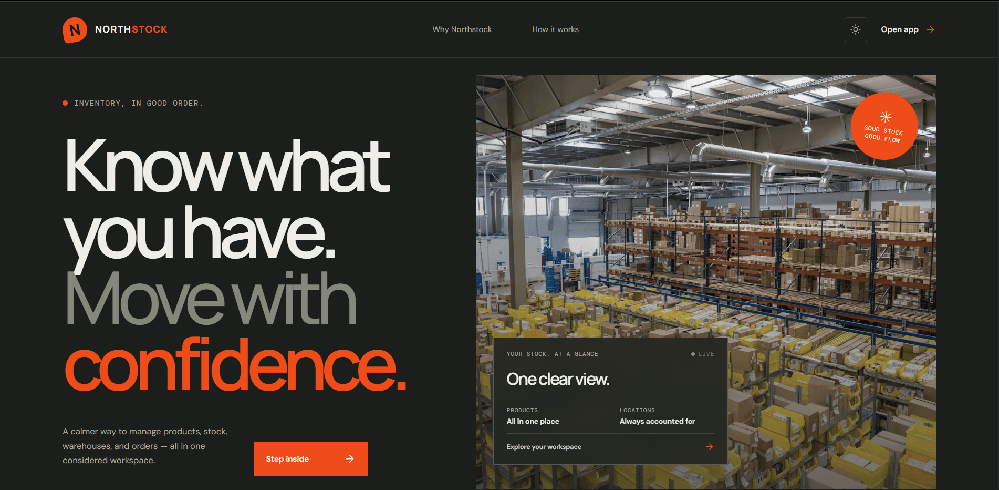

# ApexStock — Intelligent Inventory Management Platform

ApexStock is a full-stack inventory management platform designed to help businesses manage products, monitor stock levels, and streamline inventory operations. Built with React, TypeScript, Spring Boot, and PostgreSQL, the platform provides secure authentication, RESTful APIs, and a foundation for AI-powered inventory optimization.

The long-term vision is to evolve ApexStock from a traditional CRUD application into an intelligent inventory operations platform that predicts replenishment needs, recommends stock transfers across warehouses, and enables natural-language interaction with inventory data.

## Live Demo



- **Frontend:** [ApexStock — Netlify](https://YOUR-NETLIFY-DOMAIN)
- **Backend API:** [Spring Boot — Render](https://inventory-management-n8sc.onrender.com)
- **API Documentation:** [Swagger UI](https://inventory-management-n8sc.onrender.com/swagger-ui/index.html)

> Replace the frontend placeholder with your actual Netlify URL.

## Features

### Current Features

- **Product and inventory management:** Create, retrieve, update, and delete inventory records through REST APIs.
- **JWT-based authentication:** Secure authentication using Spring Security and JSON Web Tokens.
- **RESTful backend:** Structured API endpoints for communication between the frontend and backend.
- **Persistent storage:** PostgreSQL database for application data.
- **Responsive frontend:** React, TypeScript, and Vite-based user interface.
- **Cloud deployment:** Frontend deployed on Netlify and backend hosted on Render.
- **API documentation:** Swagger UI for exploring and testing backend endpoints.

### AI-Powered Inventory Intelligence — Roadmap

The following capabilities are planned to extend ApexStock beyond traditional inventory management.

#### 1. Dynamic Reorder Thresholds

Replace static reorder levels with demand-driven replenishment recommendations.

**Planned capabilities:**
- Analyze historical demand over a rolling 30-day window.
- Calculate average daily demand and demand variability.
- Estimate safety stock using a configurable service-level target.
- Incorporate supplier lead times into reorder calculations.
- Identify products that need replenishment and explain why.

**Reorder point formula:**

\[
ROP = (\bar{d} \times L) + (Z \times \sigma_d \times \sqrt{L})
\]

Where:

- \(ROP\): Reorder point.
- \(\bar{d}\): Average daily demand.
- \(L\): Supplier lead time in days.
- \(Z\): Service-level factor.
- \(\sigma_d\): Standard deviation of daily demand.

The objective is to reduce stockouts while avoiding excessive safety stock and unnecessary capital tied up in inventory.

#### 2. Multi-Warehouse FEFO Optimization

Develop a recommendation engine for balancing inventory across multiple fulfillment centers.

**Planned capabilities:**
- Monitor stock levels and reorder thresholds across warehouses.
- Identify locations with excess stock and locations facing shortages.
- Prioritize batches approaching their expiration dates using First-Expired, First-Out (FEFO).
- Rank potential transfers using distance, available surplus, and expiry risk.
- Recommend stock transfers while preserving safety-stock requirements.
- Visualize warehouse locations and transfer routes on an interactive map.

The goal is to reduce spoilage, improve stock availability, and make better use of inventory distributed across a warehouse network.

#### 3. Natural-Language Inventory Agent

Integrate Spring AI and tool calling to let managers query inventory and request operational actions using natural language.

**Example request:**

> "Find warehouses running low on milk and recommend a transfer from the nearest warehouse with sufficient surplus."

**Planned architecture:**

- Register existing Java business services as AI tools using Spring AI.
- Expose controlled tools such as `checkStock`, `getLowStockAlerts`, `getAllWarehouses`, and `executeStockTransfer`.
- Let the model retrieve inventory information through validated backend tools.
- Evaluate source availability, safety-stock constraints, and warehouse locations.
- Present proposed transfers for user confirmation before execution.
- Publish WebSocket events after successful transactions to update active dashboards.

The language model will interpret requests and coordinate tools; inventory rules, authorization, stock validation, and transactional integrity will remain enforced by the backend.

## Technology Stack

| Layer | Technologies |
|---|---|
| Frontend | React, TypeScript, Vite |
| Backend | Java, Spring Boot |
| Security | Spring Security, JWT |
| Database | PostgreSQL |
| API | REST, OpenAPI / Swagger UI |
| Frontend hosting | Netlify |
| Backend hosting | Render |
| Planned AI integration | Spring AI, LLM tool calling |
| Planned real-time updates | WebSocket |
| Planned optimization | Demand forecasting, safety-stock calculation, FEFO transfer recommendations |

## Architecture

```text
                  User
                   |
                   v
       React + TypeScript + Vite
             (Netlify)
                   |
             HTTPS / REST
                   |
                   v
        Spring Boot Application
               (Render)
                   |
          +--------+---------+
          |                  |
          v                  v
    Spring Security     Business Services
       + JWT                  |
                              v
                         PostgreSQL

       Planned AI Integration
                  |
                  v
       Spring AI Tool Calling
                  |
                  v
       Validated Java Services
                  |
                  v
       Inventory Operations
```

AI capabilities and real-time warehouse visualization are part of the planned architecture and should not be considered implemented until completed and tested.

## Getting Started

### Prerequisites

- Java version compatible with the backend build.
- Maven, if the project uses Maven.
- Node.js and npm.
- PostgreSQL, or access to a configured PostgreSQL database.
- Git.

### 1. Clone the repository

```bash
git clone https://github.com/Nimish2098/Inventory-Management.git
cd Inventory-Management
```

### 2. Configure the backend

Create or update your local environment configuration with the appropriate database and security settings.

Example environment variables:

```env
SPRING_DATASOURCE_URL=jdbc:postgresql://localhost:5432/inventory
SPRING_DATASOURCE_USERNAME=your_db_username
SPRING_DATASOURCE_PASSWORD=your_db_password
```

Configure the JWT signing secret according to the backend's existing configuration.

Do not commit passwords, signing secrets, or production credentials to version control.

### 3. Run the backend

For a Maven project:

```bash
./mvnw spring-boot:run
```

On Windows:

```powershell
.\mvnw.cmd spring-boot:run
```

The API will typically run on `http://localhost:8080`, unless configured otherwise.

### 4. Configure the frontend

Navigate to the frontend directory containing `package.json` and create a `.env` file:

```env
VITE_API_BASE_URL=http://localhost:8080
```

Use your actual backend base URL when configuring the deployed frontend.

### 5. Run the frontend

```bash
npm install
npm run dev
```

Vite will print the local development URL in the terminal, typically `http://localhost:5173`.

### 6. Build for production

```bash
npm run build
```

The generated production assets will be placed in the `dist` directory.

> Follow the repository's actual directory structure and configuration if the frontend and backend are located in separate directories or repositories.

## Security Considerations

- Protect private endpoints with authentication and authorization.
- Validate input on the backend rather than relying exclusively on frontend validation.
- Keep database credentials and JWT signing secrets in server-side environment variables.
- Enforce appropriate access controls for inventory operations.
- Validate stock availability and prevent invalid or concurrent transfers.
- Require explicit authorization and confirmation for AI-requested actions that change inventory.
- Avoid exposing sensitive inventory or customer information through logs and API responses.

## Development Roadmap

- [x] Deploy the frontend and backend.
- [x] Implement core inventory CRUD functionality.
- [x] Integrate JWT-based authentication.
- [x] Configure PostgreSQL persistence.
- [ ] Implement user profile management.
- [ ] Build demand-based reorder-point calculations.
- [ ] Add supplier lead-time and demand-history support.
- [ ] Develop multi-warehouse FEFO transfer recommendations.
- [ ] Integrate Spring AI with read-only inventory tools.
- [ ] Add transfer approval and transactional execution safeguards.
- [ ] Implement WebSocket-based inventory updates.
- [ ] Add automated tests, observability, and production hardening.

## Project Vision

ApexStock aims to make inventory operations more proactive and data-driven. Rather than simply recording stock changes, the platform is intended to help businesses anticipate shortages, reduce expiry-related waste, coordinate inventory across warehouses, and interact with operational data through natural language.

The focus is on combining reliable backend engineering with practical inventory intelligence.

## Contributing

Contributions, bug reports, and feature suggestions are welcome. Before submitting changes, ensure that the application builds successfully and that relevant functionality has been tested.


